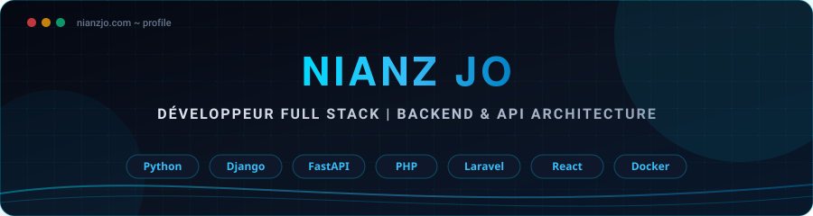

  

 

  
  
  

 

---

### 🚀 À propos de moi

- 💻 **Spécialité :** Conception d'applications web, architectures logicielles et APIs RESTful.
- ⚙️ **Focus technique :** Développement backend robuste, intégration de systèmes et automatisation.
- 📚 **Veille & apprentissage :** Intelligence artificielle appliquée, data engineering et technologies mobiles.
- 🎯 **Philosophie :** Écrire du code maintenable, sécurisé et orienté solution.

---

### 🛠️ Stack technique

#### 🔹 Backend & API

  
  
  
  
  

#### 🔹 Frontend & Mobile

  
  
  
  

#### 🔹 Bases de données & DevOps

  
  
  
  

---

### 📊 Activité GitHub

  
  

---

### 📂 Projets & Réalisations

  
Retrouvez mes dépôts et réalisations en libre accès :

  

 

  <em>« Construire. Apprendre. Améliorer. Recommencer. »</em>

